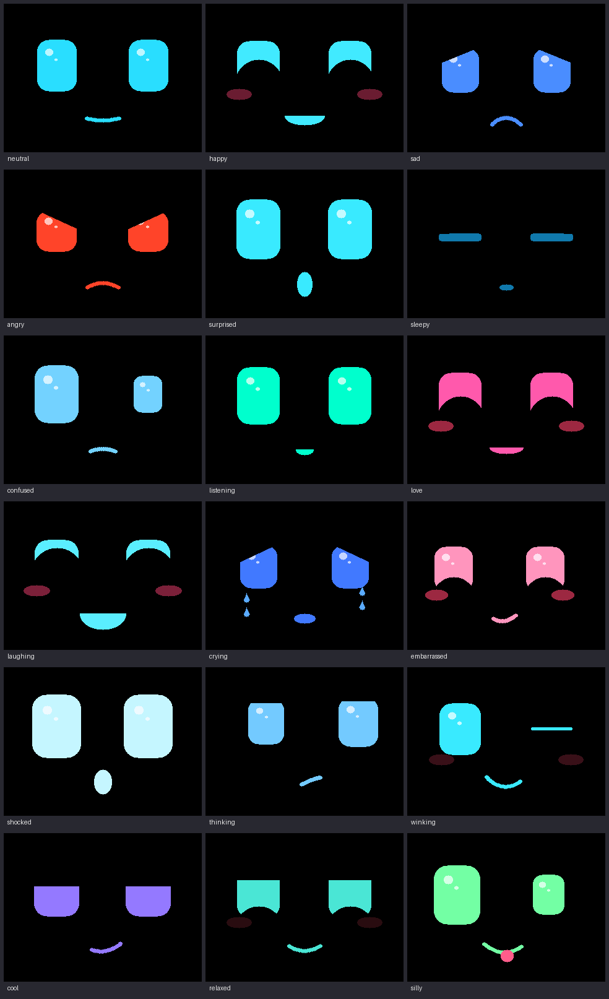

# Claude Gadget: desk companion

[](https://github.com/ecstoneusps/Claude-gadget/actions/workflows/build.yml)

A small desk buddy built on the **M5Stack CoreS3** (ESP32-S3). It shows an
animated face that blinks, glances around, and changes expression. It chirps,
giggles, purrs and yawns through its speaker, reacts to touch, motion and sound,
and understands spoken commands offline after you say **"Hey Buddy"**.



## Talking with it (AI conversation)

With Wi-Fi and a Home Assistant server set up, you can have a real
conversation: say **"Hey Buddy"**, then ask anything ("what's a good name for
a cat?", "tell me about Saturn"). It looks thoughtful while it works out an
answer, then replies **out loud** with its mouth moving along and its face
showing the mood of the answer. After it answers it keeps listening for about
5 seconds, so you can carry on talking without saying "Hey Buddy" again.

How it works: what you say goes to Home Assistant's voice assistant over its
websocket API. Whisper turns it into text, and the conversation agent (a
language model on your own PC, through Ollama) writes the answer, starting with
an emotion tag such as `[laughing]` that picks the face. Piper turns the answer
into speech. All of it runs on your own machines. The setup guide covers the
Home Assistant side step by step.

- The face and mood commands below (look left, wink at me, be cool, good night,
  be quiet...) still run on the buddy itself when you say just that. Everything
  else, including "tell me a joke" and "how are you", goes to the AI.
- It remembers the conversation for 5 minutes, so "what about Jupiter?" works
  after a question about Saturn.
- Without Wi-Fi, or if Home Assistant can't be reached, it falls back to the
  built-in commands.
- "Be quiet" turns off its sound effects, but it still speaks its answers.

Fill in `wifi_name`, `wifi_password`, `ha_url` and `ha_token` in `settings.txt`
(see [Settings](#settings-microsd-card)). Keep the card private: the token works
like a password for the Home Assistant user it belongs to.

### Speaking sooner

Buddy starts saying each sentence as soon as the AI has written it, instead of
waiting for the whole answer (the AI's reply arrives bit by bit; each complete
sentence is turned into speech while the next is still being written). Short
answers sound the same; long ones start much sooner. Nothing to set up.

### A more natural voice (Kokoro)

Piper's voice is clear but flat. [Kokoro](https://huggingface.co/hexgrad/Kokoro-82M)
is a small, free, local voice model that sounds much more human and runs fine
on a PC's CPU (no GPU needed). Run it with Docker on the PC that runs Ollama:

```
docker run -d --name kokoro --restart unless-stopped -p 10210:10210 ghcr.io/relvacode/kokoro-wyoming:latest
```

Then in Home Assistant: **Settings → Devices & services → Add integration →
Wyoming Protocol**, the PC's address and port **10210**. Then **Settings →
Voice assistants → Buddy**, set **Text-to-speech** to **Kokoro** and pick a
voice (try `af_heart` or `am_michael`; the list is in the
[voices documentation](https://huggingface.co/hexgrad/Kokoro-82M/blob/main/VOICES.md)).
Buddy uses whatever voice the assistant is set to, no change on his side.

### Searching the web (optional)

A local AI model only knows what it learned in training. To let it look things
up when it doesn't know (news, "who is the oldest living person?"), give it a
search tool in Home Assistant. This uses **SearXNG**, a free search engine you
run yourself with Docker (no account or API key; it asks the big search
engines for you). Your chat model has to support tools: on the PC run
`ollama show <model>` and look for `tools` under Capabilities (qwen3,
llama3.1/3.2 and mistral-nemo do; gemma3 doesn't).

1. On the PC: `docker run -d --name searxng --restart unless-stopped -p 8888:8080 -v C:\searxng:/etc/searxng searxng/searxng`.
   Then open `C:\searxng\settings.yml`, make sure it has (under the existing
   `search:` section if there is one):
   ```yaml
   search:
     formats:
       - html
       - json
   ```
   and run `docker restart searxng`. Check it: `http://localhost:8888/search?q=test&format=json` shows text, not "403 Forbidden".
2. In Home Assistant's `configuration.yaml` (with the PC's address), then restart:
   ```yaml
   rest_command:
     web_search:
       url: "http://192.168.4.98:8888/search?q={{ query | urlencode }}&format=json&language=en"
       method: GET
       timeout: 20
   ```
3. A script the AI can call: **Settings → Automations & scenes → Scripts → Add
   script → ⋮ → Edit in YAML**, paste, save:
   ```yaml
   alias: Web search
   description: >-
     Search the internet. Use this when asked about current events, recent facts,
     or anything you don't know or aren't sure about. Returns the top results.
   fields:
     query:
       description: What to search for, as a short search query.
       required: true
       selector:
         text:
   sequence:
     - action: rest_command.web_search
       data:
         query: "{{ query }}"
       response_variable: search
     - variables:
         found: >-
           
           
             
           
           {{ {'answers': search.content.answers | default([]), 'results': ns.items} }}
     - stop: Search done
       response_variable: found
   ```
4. **Settings → Voice assistants → Expose**: expose the **Web search** script
   to Assist. The conversation agent (your Ollama integration) must have
   **Control Home Assistant** set to **Assist**, which lets it use exposed
   scripts as tools. Optionally add to its instructions: "If you don't know
   something or it may have changed recently, use the web search tool."

## Remembering things

Tell him something to keep: **"Remember that my dog's name is King"**, "don't
forget that I like my coffee black", "make a note that the car needs an oil
change". He says it back ("Got it! I'll remember that your dog's name is
King") and writes it as a line in **`memories.txt`** on the SD card. At the
start of each conversation the AI is given those notes, so later "what's my
dog's name?" gets "King!" (the vision model sees them too).

- **"Forget that"** removes the last note; **"forget that my dog's name is
  King"** removes that one; **"forget everything"** clears them all (the old
  list is kept as `memories-backup.txt`).
- **He also learns by himself.** About a minute and a half after a chat goes
  quiet, the AI looks it over and adds lasting facts it heard (names,
  birthdays, likes, plans) to his notes; the log shows `learned: "..."`.
  `learn = off` turns that off.
- `memories.txt` is plain text, one note per line. Read, fix or delete notes on
  the **settings page** ("Things Buddy remembers", accepted with a tap on his
  screen) or on your computer. Lines starting with `#` are ignored.
- `memory = off` in settings.txt turns notes off altogether.

## Taking pictures and seeing

The camera stays off until you ask for it (with `face_tracking = off`, the
default since tracking costs a lot of CPU for little movement on this screen).

- **"Take a picture"** (or "take a photo of me", "say cheese"): the screen shows
  the camera's view with a 3-2-1 countdown, flashes, shows the photo, and saves
  it as `photos/IMG_0001.jpg`, `IMG_0002.jpg`... (320x240) on the SD card.
  Works without Wi-Fi.
- **"What do you see?"**, "what am I holding?", "can you read this?", "how do I
  look?": it takes a photo and sends it, with your question, to a vision model
  in Ollama on your PC, then says the answer with a matching face. For about a
  minute afterwards, follow-up questions ("what colour is it?") are about the
  same photo. Photos taken just to look aren't saved.

Vision setup (once): on the PC run `ollama pull gemma3:4b`, then set
`vision_url` to Ollama's address (the same one Home Assistant uses, e.g.
`http://192.168.4.98:11434`) in settings.txt. Any Ollama vision model works
(`vision_model`); gemma3:4b fits next to the chat model on a 12 GB card.

**Seeing away from home** (with `ha_url_away`): Ollama has no password, so it
must never be put on the internet. Instead, away from home Buddy sends the
photo through his Home Assistant connection, and Home Assistant passes it to
Ollama on the home network. Add this to Home Assistant's `configuration.yaml`
(with Ollama's address), restart Home Assistant, and that's it:

```yaml
rest_command:
  buddy_vision:
    url: "http://192.168.4.98:11434/api/chat"   # Ollama on the PC (same as vision_url)
    method: POST
    content_type: "application/json"
    timeout: 120
    payload: >-
      {"model": {{ model | tojson }}, "stream": false, "keep_alive": "10m",
       "messages": {{ messages | tojson }}}
```

At home Buddy still talks to Ollama directly (a little faster).

## Voice commands

Say **"Hey Buddy"**. The face switches to its listening look, and you then have
about 6 seconds to say one of these. With the AI connected, these work the same
way for the face and mood commands; the chatty ones (hello, how are you, jokes,
compliments) are answered by the AI instead:

| Say | It does |
|---|---|
| hello / good morning / hi there | Happy |
| how are you | Happy (sleepy if the battery is low) |
| i love you / you are cute | Love eyes and blush |
| thank you | Love eyes |
| good job / well done / you are awesome | Happy |
| bad robot / stop it | Sad |
| tell me a joke / make me laugh | Laughs |
| look left / look right | Looks that way |
| be happy / be sad / be angry / be surprised | Shows that expression |
| be cool / make a silly face (or "act goofy") | Heavy-lidded smirk / lopsided eyes with its tongue out |
| wink at me / give me a wink / do a wink | Winks |
| good night / go to sleep | Yawns, then sleeps and dims until "Hey Buddy", a tap, or a shake |
| wake up | Startled awake |
| be quiet / quiet please | Turns its sounds off (remembered after a restart) |
| louder / speak up / turn it up / volume up / talk louder | Volume up 10 (saved to `volume` in settings.txt) |
| quieter / turn it down / volume down / talk quieter | Volume down 10 (saved too; never below 10) |
| take a picture / take a photo / take a selfie / say cheese | Live view with a countdown, then saves `photos/IMG_0001.jpg`... (320x240) on the SD card |
| what do you see / what is this / what am I holding / look at this | Takes a photo and describes it out loud (needs the AI and a vision model, see below) |
| sound on / you can talk | Turns its sounds back on |

If it doesn't catch a command, it looks confused for a moment.

All recognition runs on the device with Espressif's
[ESP-SR](https://github.com/espressif/esp-sr) models: the WakeNet "Hey Buddy"
wake word and the MultiNet7 English command recognizer. Nothing is sent to the
internet (with the AI set up, what you say after "Hey Buddy" goes to your own
Home Assistant server). To change the phrases, edit `kCommandPhrases` in
`components/companion/Companion.cpp`. Phrases must be lowercase letters and spaces only.

By default it listens with **one microphone**. `two_microphones = on` in
`settings.txt` uses both: ESP-SR's blind source separation then pulls your voice
apart from other sounds, and the wake word detector checks both channels. On the
CoreS3 that costs much more CPU than Espressif's benchmarks suggest. In testing
it slowed the face animation to 5 fps, so try it if it struggles to hear you in a
noisy room. The serial log prints the active audio chain at boot.

## Expressions and emotions

The face has 18 expressions (above). Each is a set of numbers, such as eye size,
lid angles, mouth curve, tears, tongue and color, so any two blend smoothly into
each other.

It also understands the **21 emotion names** that AI voice servers like
[xiaozhi-esp32](https://github.com/78/xiaozhi-esp32)'s attach to their replies:
neutral, happy, laughing, funny, sad, angry, crying, loving, embarrassed, surprised,
shocked, thinking, winking, cool, relaxed, delicious, kissy, confident, sleepy,
silly and confused. `Companion::onEmotion("laughing")` shows the closest expression
with a matching sound. That's the hook a future "talk with AI" feature will use.
The mapping is `kEmotionMap` in `components/face/Face.cpp`.

## Sound effects

Every sound is synthesized in code (`components/sfx/Sfx.cpp`), so there are no
audio files to manage, and the mouth moves along with each sound. There are two
voices, picked with `sound_style` in `settings.txt`:

- **puppy** (default): wufs, yips, arfs, panting, whines, a soft growl.
  Hear them on a PC in `preview/sounds/`.
- **robot**: the original chirps and boops, in `preview/sounds_robot/`.

To use your own recording for any sound, put a WAV file named after it in a
`sounds` folder on the card (for example `sounds/happy.wav`; any sample rate,
mono or stereo, up to 2 MB). It replaces the built-in one at startup, and the
mouth follows its loudness.

| Sound (puppy) | When |
|---|---|
| chirp (wuf) | Heard "Hey Buddy", or sound turned back on |
| boop (yip) | Tapped; looking left or right |
| happy (arf arf) | Greeted, praised, or told to be happy |
| giggle (panting) | Asked for a joke |
| love (happy whine) | "I love you", "thank you" |
| purr (soft rumble) | Being petted (repeats while you hold it) |
| sad (whimper) / angry (growl) / surprised (yip) | Scolded or told to show that feeling; a clap surprises it |
| confused | Shaken, or didn't catch a command |
| yawn | Dozing off or told good night |
| wake | Startled awake |

Audio is **full duplex**: the speaker and both microphones run at the same
time on one I2S port, so it keeps listening while it chirps. That covers "Hey
Buddy" and commands. Its own sounds are ignored by the clap and "someone is
talking" reactions. The approach follows
[xiaozhi-esp32](https://github.com/78/xiaozhi-esp32)'s CoreS3 driver (MIT),
using Espressif's `esp_codec_dev`. Volume is `volume` in `settings.txt`.

## Other reactions

| You do | It does |
|---|---|
| Sit down in front of it (or wave near the top of the screen) | Wakes up, looks up at you and says hello |
| Walk away | Dozes off after about 20 seconds instead of a minute |
| Move around in front of it | Its eyes follow your face (camera) |
| Come back into view while it's dozing | Wakes up and says hello (camera) |
| Tap the screen | Happy |
| Hold a finger on it ("petting") | Love eyes and blush |
| Shake it | Confused / dizzy |
| Tilt it | Eyes look toward the tilt |
| Clap | Surprised |
| Talk near it (without "Hey Buddy") | Listens, then a happy "I heard you" |
| Leave it alone for 1 minute | Gets sleepy |
| Leave it alone for 3 minutes | Dims the screen |
| Let the battery drop below 10% | Stays sleepy until charged |

## Camera

The CoreS3's camera, a GC0308 above the screen, runs Espressif's
[face detection model](https://github.com/espressif/esp-dl/tree/master/models/human_face_detect)
on the device: 5 frames a second while awake, 1 while dozing, and none after
"good night". The eyes turn toward the biggest face it sees. **Images never leave
the device and are never stored.** Each frame is analyzed in memory and
discarded. The serial log prints the face position every few seconds.

## Presence radar (optional)

An HLK-LD2410 / LD2410B / LD2410C 24 GHz radar module makes "someone sat
down / they left" far more reliable than the built-in proximity sensor: it
notices you sitting perfectly still, a metre or two away, and it sees through
thin plastic, so it can hide inside a printed body.

Wire it to **Port C** (the blue Grove port) with a Grove-to-female-jumper cable: (M5Stack's ports have no room for
the latch on standard Grove plugs: cut the latch hook off, or use M5Stack's own
latch-free Grove-to-Dupont cable):

| Grove wire | Port C | LD2410 pin |
|---|---|---|
| red | 5 V | VCC |
| black | GND | GND |
| yellow | GPIO 18 (Buddy receives) | TX |
| white | GPIO 17 (Buddy sends) | RX |

If the yellow and white wires end up the other way round, the buddy notices
and swaps them in software. When a radar is detected it takes over from the
proximity sensor, and face detection (the heaviest job after speech) pauses
whenever nobody is at the desk; the log shows `radar: still, nearest 82 cm ...` every 10
seconds, and `radar_distance_cm` in settings.txt sets how close counts as at
the desk.

## Project layout

```
components/face/       Face engine: expressions, tweening, blinking, gaze (portable C++)
components/companion/  The "brain": events -> expressions + sounds, voice command list (portable C++)
components/sfx/        Sound effect synthesizer (portable C++)
main/main.cpp          CoreS3 glue: display, touch, IMU, battery, main loop
main/voice.cpp         ESP-SR pipeline: mic -> audio front-end -> wake word -> commands
main/audio_io.cpp      Full-duplex audio: ES7210 mics + AW88298 speaker amp on one I2S port
main/sound.cpp         Sound effect player task (streams to the speaker while the mics listen)
main/i2c_bus.cpp       The shared internal I2C bus (M5Unified, camera and audio chips)
main/proximity.cpp     LTR-553 proximity sensor driver (presence logic is in components/companion/Presence.*)
main/radar.cpp         LD2410 presence radar on Port C (frame parser: components/ld2410, portable)
main/camera.cpp        Camera setup and face detection task
main/settings.cpp      Settings kept across restarts in flash (NVS): currently mute
main/sdcard.cpp        microSD card (shares the display's SPI bus)
main/wifi.cpp          Wi-Fi station (reconnects on its own)
main/assistant.cpp     Home Assistant voice assistant client: streams speech, gets the answer, plays it
components/assist/     Reply parsing (emotion tags, text cleanup), command matching, WAV decoding (portable C++)
components/config/     settings.txt parser and the default file (portable C++)
sdcard/                Files for the SD card: settings.txt as written to a fresh card
components/espdl_all_ops/  Build helper: makes esp-dl compile every neural-network op the face model may need
tests/                 Native unit tests for the brain (run on a PC)
tools/preview/         Renders the face to PNG/GIF on a PC
partitions.csv         Flash layout (7 MB app + 8 MB speech models; ~4.1 MB and ~3.1 MB used)
sdkconfig.defaults     Board, PSRAM and speech model settings
```

`components/face`, `components/companion`, `components/sfx`, `components/config`
and `components/assist` contain no ESP32 code, so they build and run on a PC for testing and previews.

## Build and flash

This project uses **ESP-IDF** (tested with v5.4.1), Espressif's official framework.
ESP-SR's speech models install automatically with it.

1. Install ESP-IDF. The easiest way is VS Code with the **ESP-IDF** extension
   (Espressif's own); its setup wizard installs everything. Alternatively,
   follow the [ESP-IDF getting started guide](https://docs.espressif.com/projects/esp-idf/en/stable/esp32s3/get-started/).
2. Plug the CoreS3 in over USB-C. Use a data cable, not a charge-only one.
3. In an ESP-IDF terminal, from this folder:
   ```
   idf.py set-target esp32s3      # first time only
   idf.py build
   idf.py flash monitor
   ```
   The first build downloads M5Unified and ESP-SR through the component
   manager. `idf.py flash` also writes the speech models to the `model` partition.
   Later, `idf.py app-flash` skips rewriting the models and is faster.

If flashing can't find the board, hold the reset button on the side for about
3 seconds until the green LED lights. That puts it in download mode.

The serial monitor logs every wake word and command, with a confidence value,
which helps with tuning.

### Flash a ready-made build (no ESP-IDF needed)

GitHub Actions builds the firmware on every push (`.github/workflows/build.yml`).
To flash it without installing ESP-IDF:

1. Open the repository's **Actions** tab, pick the latest green **Build** run, and
   download the **desk-companion-firmware** artifact. Unzip it.
2. Install esptool with `pip install esptool`.
3. With the CoreS3 plugged in:
   ```
   cd desk-companion-firmware/build
   python -m esptool --chip esp32s3 write-flash '@flash_args'
   ```
   Keep the quotes around `'@flash_args'`. Windows PowerShell treats a bare `@`
   as special and silently drops the argument, so esptool reports a missing
   address and filename.

The artifact also contains `dependencies.lock`, the exact library versions that
build used. Commit it to the repo root to pin those versions for future builds.

## Tests and preview (on a PC)

```
tests/run_tests.sh                      # unit tests for the brain and settings parser (needs g++)
python3 tools/preview/make_preview.py   # face images + sound WAVs (needs g++ and Pillow)
```

## Settings (microSD card)

### Editing them from a browser

Once Buddy is on Wi-Fi you don't need to take the card out. For 20 seconds
after he connects, the bottom of his screen shows his settings page's address,
e.g. `Settings: http://192.168.4.134/` (the log shows it too, and many routers
also answer to `http://desk-buddy/`). Open it on a phone or PC on the same
network to edit `settings.txt`, then press **Save** and **tap Buddy's screen
within a minute** to accept. He saves the file and restarts with the new
settings. Nothing changes without that tap, so nobody else on the network can
change him unnoticed. Wi-Fi passwords and the Home Assistant token show as
`********` and are never sent to the browser: leave them like that to keep
them, or type a new one over them. The page lists any lines with mistakes
(those are ignored, as usual).

**If no saved Wi-Fi network works** (out of range, a wrong name or password)
for 2 minutes, or none is saved yet, Buddy opens his own open Wi-Fi network,
**`Buddy Setup`**, and his screen says so. Join it with your phone (ignore the
"no internet" warning) and open **http://192.168.71.1/** to fix the settings;
the tap on his screen is still needed. He keeps looking for his saved networks
meanwhile and turns the setup network off once one works.
`setup_hotspot = off` turns this off.

Put a FAT32-formatted microSD card in the slot on the side. On its first start
with the card, the buddy writes a commented **`settings.txt`** to it (the same
file as [`sdcard/settings.txt`](sdcard/settings.txt) in this repo, which you can
also copy onto the card yourself). Edit it on your computer, put the card back,
and restart the buddy.

| Setting | What it changes |
|---|---|
| `volume`, `brightness`, `dim_brightness` | Speaker and screen levels, 0-100 |
| `sleep_after_seconds`, `dim_after_seconds`, `sleep_after_leaving_seconds` | How quickly it gets sleepy and dims |
| `command_confidence` | Raise to around 0.3 if it reacts to things you didn't say. The serial log shows each command's confidence |
| `say.<command> = phrase, phrase` | Extra ways to say any command, e.g. `say.hello = howdy, whats up buddy` |
| `face_tracking`, `camera_mirrored`, `face_gaze` | Camera on/off, fix eyes that look away from you, how far they turn |
| `face_model` | `fast` (MSR+MNP, default) checks about 14 times a second; `accurate` (ESPDet-Pico) finds you more often per check but takes ~0.5 s each and slows the animation |
| `photo_flash` | The screen lights up white at full brightness while a photo is taken: brighter close-ups in a dim room, but shiny things show a reflection |
| `camera_preview` | Show what the camera sees, with a green box around a detected face (for troubleshooting) |
| `proximity`, `proximity_sensitivity` | Proximity sensor on/off; lower sensitivity numbers notice you from further away |
| `radar`, `radar_distance_cm` | Use an LD2410 presence radar on Port C (see below); how close counts as at the desk |
| `screen_flip` | `on` (default): the CoreS3 is mounted turned around, camera at the top, as in the puppy head; turns the picture, the camera image and the tilt directions to match. `off` for the plain CoreS3 |
| `flip_tilt_x`, `flip_tilt_y` | Fix tilt reactions that go the wrong way |
| `wifi_name`, `wifi_password` | Your home Wi-Fi (2.4 GHz). Put the password in "quotes" if it contains a `#` |
| `ha_url` | Home Assistant's address with its IP and port, e.g. `http://192.168.1.20:8123` (`.local` names don't work), used on the home network |
| `wifi_name_2`, `wifi_password_2`, `wifi_name_3`, `wifi_password_3` | Optional extra networks, such as your phone's hotspot (set it to 2.4 GHz / "maximize compatibility"). Buddy joins the first network in the list that's in range, and looks again whenever the connection drops |
| `setup_hotspot` | `on` (default): if no saved network works for 2 minutes, Buddy opens the `Buddy Setup` Wi-Fi so you can reach the settings page at http://192.168.71.1/ |
| `ha_url_away` | Optional: Home Assistant's address from anywhere else, used on any network but the home one, e.g. a Tailscale Funnel address `https://homeassistant.your-tailnet.ts.net`. "What do you see?" then goes through Home Assistant (see "Seeing away from home"), so Ollama itself never has to be on the internet |
| `ha_token` | A long-lived access token for the Home Assistant user the buddy logs in as |
| `ha_pipeline` | The voice assistant to use, by its name in Home Assistant (default `Buddy`) |
| `conversation` | `off` uses only the built-in commands, even with the above filled in |
| `follow_up` | `off` makes it go back to waiting for "Hey Buddy" after each answer |
| `vision_url`, `vision_model` | Ollama's address and a vision model, for "what do you see?" |
| `memory` | `off` stops "remember that ..." notes (kept in `memories.txt`) |
| `welcome_back_minutes` | After you've been away at least this long (20 minutes by default), Buddy says hello out loud when you come back ("Welcome back!", "You're back! I missed you so much."). Needs Home Assistant; stays silent while "be quiet" is on. `0` turns it off |

When an update adds new settings, they're added to the end of your
`settings.txt` (at their default values, with their explanations) the next
time it starts, so the file always lists everything you can change. A setting
you commented out with `#` is left alone.

Mistakes, such as a typo or an out-of-range number, are listed in the serial log,
and that line is ignored. Without a card, it uses the built-in defaults. The
mute setting ("be quiet" / "sound on") is kept in the board's own flash and
works without a card.

## Tuning in code

- **Expressions:** `paramsFor()` in `components/face/Face.cpp`.
- **Reactions:** `Companion::onCommand()` and the tunables in `components/companion/Companion.h`.
- **Built-in phrases:** `kCommandPhrases` in `components/companion/Companion.cpp`.
- **Default settings:** `components/config/BuddyConfig.h`. After changing one, run
  `tests/run_tests.sh --write-settings` to refresh `sdcard/settings.txt`.
- **Different wake word:** run `idf.py menuconfig` → *ESP Speech Recognition* →
  *Load Multiple Wake Words*. Choose one, such as "Hi M Five", "Jarvis" or "Computer",
  and turn off "Hey Buddy".
- **Doesn't notice you sitting down:** the proximity sensor (just above the screen)
  is infrared and short-range, roughly a hand's length to an arm's length depending on
  what you're wearing. The serial log prints `prox <reading>, baseline <empty desk>`
  every 10 seconds. Compare the numbers with you seated and away, then lower
  `proximity_sensitivity` in settings.txt, or angle the buddy toward you.

## Roadmap

1. ~~Face engine and desktop preview~~
2. ~~Touch, motion and sound reactions~~
3. ~~Offline wake word and voice commands~~
4. ~~Test on hardware and tune thresholds~~
5. ~~Use both microphones for better pickup across a room~~
6. ~~Sound effects through the speaker (chirps, giggles, yawns)~~
7. ~~Proximity sensor: wake up when someone sits down~~
8. ~~Camera: look toward your face~~
9. ~~Remember the mute setting across restarts~~
10. ~~Settings file on the SD card~~
11. Recognize you (face recognition, enrolled face stored on the card)
12. ~~AI conversation: speech-to-text → LLM → emotion tag drives the face, with spoken replies~~
13. Home Assistant sensors and controls over MQTT (desk occupied, light level, battery, mood)
14. Maybe: a moving head (pan/tilt servos), e.g. M5Stack StackChan's body: see [docs/motorizing-notes.md](docs/motorizing-notes.md)
