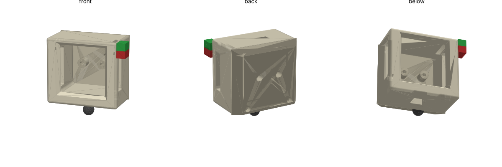

# Badware head for Buddy (CoreS3)

A monitor head that holds an M5Stack CoreS3 with its DIN base, for the
Badware figure. The rest of the body is the original model printed at 135 %.

Remixed from **"Die of Death badware articulated figure" by GigaBagel
(@GigaBagel777)** on Printables (https://www.printables.com/model/1410750),
licensed **CC BY 4.0** (https://creativecommons.org/licenses/by/4.0/). The
original file is in `original/`. The CoreS3 pocket, its side windows and the
screwed back cap come from the puppy head in `../puppy` (remix of "Puppy
Stand - M5Stack Core S3" by John White, CC BY 4.0). This remix is shared under
the same license.

Rebuild the STLs: `pip install manifold3d trimesh numpy`, then
`python3 badware.py stl/`.

## Parts

| File | Size (mm) | Print |
|---|---|---|
| `stl/badware_head.stl` + `badware_head_green.stl` + `badware_head_red.stl` | 80 x 73 x 47 | **Face down** (the front on the bed). Load the three as **one object with three parts** and give the green and red parts their own filament (the block on his side). No supports: the screen's sloped frame and the block sit on the bed, the CoreS3 pocket opens upward. The side windows' far edges are 44 mm bridges |
| `stl/badware_back_cap.stl` | 80 x 73 x 20 | Back face down, posts up. No supports |
| `stl/badware_neck.stl` | 16 x 14 x 25 | Peg down, ball up (like the original's head). Print it in the **same material as the body** (PETG) so the ball holds in its socket |
| `stl/badware_torso.stl`, `badware_arm_a/b.stl`, `badware_leg_a/b.stl`, `badware_chest_plate.stl` | already 135 % | The original's body with **fixed joints** (`static_body.py`): every ball is a diamond peg and every socket a matching diamond hole, so each part goes in at one of four quarter-turns and is **glued** in a fixed pose. Print them as the original's parts lie in the file (no scaling). The diamonds print without supports lying or standing |
| `stl/badware_base.stl` | 120 x 90 x 12 | **Upside down** (as it comes: top on the bed). Pockets for his feet on top; a pocket underneath for weight |

Suggested for the head and cap: PLA, 0.2 mm layers, 3 walls, 15 % infill.

## Assembly

1. **Body:** dry-fit first. Each diamond peg goes in at one of four
   quarter-turns: pick the pose (arms hanging, toes forward), then glue each
   joint (super glue, or epoxy for PETG). Glue the chest plate on.
2. **Base:** fill the weight pocket underneath (coins, steel nuts or washers,
   about 150-250 g) and hold them with hot glue; felt pads or a sheet of craft
   foam over it protect the desk. Glue his feet into the pockets on top.
3. **Neck:** push the plug's square peg into the socket under the head (it's
   snug: 0.25 mm clearance) with a drop of super glue, diamond pointing down.
4. **CoreS3:** turned around (camera at the top of the screen, Ports B and C
   facing down), slide it in from the back, screen first, against the front
   frame. `screen_flip = on` in settings.txt (the default).
5. **Back cap:** fit its groove over the head's rim. 2 x M3 x 16 socket-head
   screws through the posts into the DIN base's brass nuts (they hold the
   CoreS3 against the front), 2 x M3 x 16 into the head's floor at the bottom
   corners (printed 2.5 mm pilot holes: stop at snug).
6. Glue the neck's diamond into the torso's neck hole, facing forward.

## Things to know

- **Weight:** the CoreS3 with its DIN base is much heavier than the
  original's plastic head, which is why the joints are fixed and he stands on
  a weighted base: with the ball joints he tipped over at a touch.
- **Size:** the head is 80 mm wide and 73 mm tall; with the 135 % body he
  stands about 20 cm tall.
- **Print a test first:** the head and the body at 135 % fit on a PLA test
  print. The fixed joints (diamond pegs, 0.2 mm clearance each side for
  glue) and the base haven't been printed yet: try one arm in the torso
  before printing everything.
