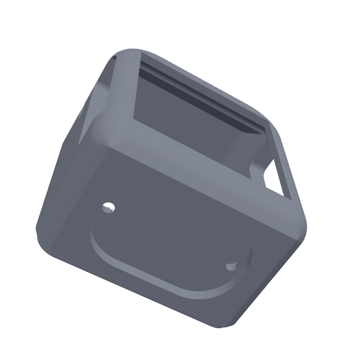
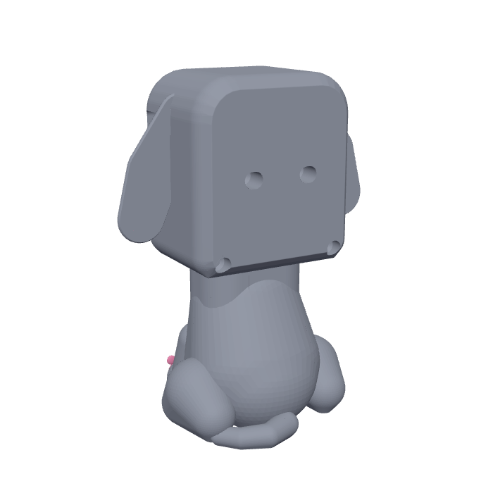
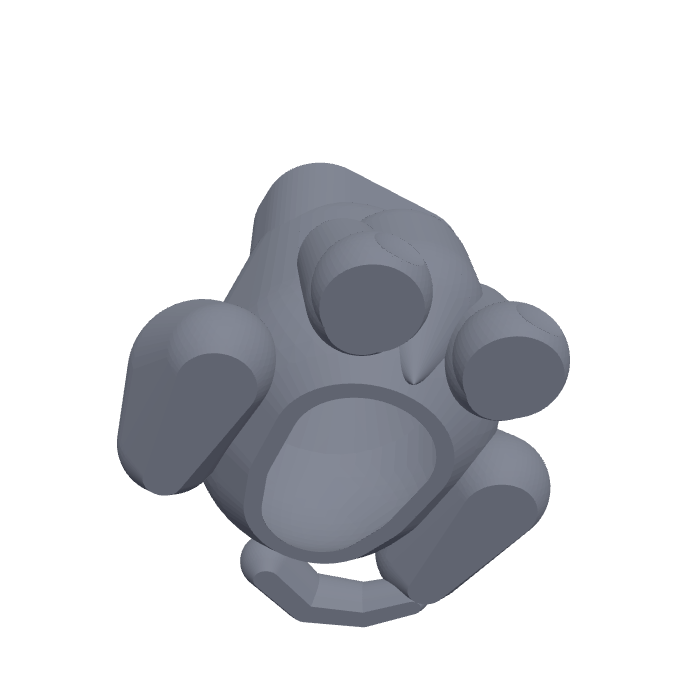

# Puppy body for Buddy

A chibi, sitting puppy body for the M5Stack CoreS3 with its DIN base
(33.5 mm deep), with floppy ears, pink inner ears and paw pads, room for Grove
cables, and an LD2410 presence radar in the chest.

Remixed from **"Puppy Stand - M5Stack Core S3" by John White**
(Printables), licensed **CC BY 4.0**
(https://creativecommons.org/licenses/by/4.0/). The openings for the CoreS3's
buttons and ports are placed where the original frame has them. This remix is
shared under the same license.

## Parts (`stl/`, already turned to their printing position)

| File | Size (mm) | Notes |
|---|---|---|
| `buddy_head.stl` | 67 x 44 x 73 | **Standing upright** on its bottom, as it sits on Buddy. The dome prints as a smooth top surface and the bottom edges are a 45-degree chamfer, so the outside needs no supports. The top of the screen window is a 50 mm bridge and the side windows 13.5 mm bridges: fine with normal bridging settings (add a support enforcer there if yours sag). Inside, the ceiling over the CoreS3 is 45-degree slopes and a flat bridge, all hidden. A 0.4 mm skin closes the opening in the floor at the top of the neck socket so its edges print cleanly: **cut it out** with a hobby knife after printing. Tip: variable layer height smooths the top of the dome |
| `buddy_back_cap.stl` | 67 x 73 x 20 | **Back side down**, posts and groove facing up. The back edges are a 45-degree chamfer: no supports |
| `buddy_ear_left.stl` + `buddy_ear_left_pink.stl` | 26 x 55 x 4 | Flat side down, no supports. Load both as **one object with two parts**; pink part on the top |
| `buddy_ear_right.stl` + `buddy_ear_right_pink.stl` | 26 x 55 x 4 | Same |
| `buddy_body.stl` + `buddy_body_pink.stl` | 78 x 77 x 70 | Standing on its open bottom. Load both as **one object with two parts** (pink = paw pads, set flush into the front paws). **No supports**: every underside, inside and out, slopes at 45 degrees or less down to the bed, and the tail lies on the floor |

Suggested: PLA, 0.2 mm layers, 3 walls, 15 % infill. In Anycubic Slicer Next
(or any Orca-based slicer), select a part and its `_pink` file together and
answer **Yes** to "load as a single object with multiple parts", then give the
pink part its own filament slot on the ACE Pro.

### Screws

All M3, with heads that sit flush with or below the surface:

| Qty | Screw | Joins |
|---|---|---|
| 2 | M3 x 12 socket head | head to neck: driven up from under the body, through the neck, into the head's floor |
| 2 | M3 x 16 socket head | back cap to the CoreS3 (into the DIN base's brass nuts) |
| 2 | M3 x 16 socket head | back cap to the head's floor, at its bottom corners |

The holes into plastic are printed 2.5 mm pilots: the screws cut their own
thread the first time. Stop at snug, since PLA threads strip if forced.

## Inside

- **Head:** the CoreS3 goes in **turned around** compared with the original
  stand: camera at the top of the screen, Ports B and C facing down over the
  opening in the floor, so the radar cable plugs straight in from the neck
  (set `screen_flip = on` in `settings.txt`, the default, so the picture,
  camera and tilt match). It slides in from the back, screen first, against
  the front lip. The side windows (power button, USB-C and Port A on one side,
  the speaker on the other) line up either way. The pocket's edges around the
  front are square, so the CoreS3 sits flat against the front lip all round.
  The opening under the ports is 34 x 16 mm; two blind pilot holes in the
  floor behind it, over the neck's back wall, take the neck screws.

  
- **Back cap:** a U-shaped groove fits over a rim around the left, bottom and
  right of the head's back opening. Two screws through posts in the middle go
  into the brass nuts in the DIN base's back panel and clamp the CoreS3 against
  the front lip, so it can't slide back when you touch the screen; two at the
  bottom corners hold the cap to the head. Their heads sit in counterbores.

  
- **Body:** hollow, open at the bottom. The neck on top is a hollow oval tube
  that fits into the socket under the head, with two bosses in its back wall
  for the head screws; tunnels below them let a long hex key reach up from the
  open bottom.
  In the middle of the body, two grooved cheeks hold the radar board upright
  (22 x 16 mm), antenna side forward, about 20 mm behind the chest, which the
  24 GHz radar sees through.

  

## Assembly

You need a 2.5 mm hex key with a long arm (about 65 mm of reach) for the neck
screws.

1. Push each ear's tab into the slot on the side of the head (left ear on the
   left), with a drop of super glue.
2. Plug the Grove-to-jumper cable onto the radar (red VCC, black GND, yellow
   TX, white RX). Drop the board **down through the neck** into the grooves,
   antenna side (the side with the chip and gold patches) facing forward, pins
   up, until it rests on the grooves' bottom ends. A dab of hot glue keeps it
   from rattling. Leave the Grove end sticking up out of the neck.
3. Slide the CoreS3 into the head from the back, screen first, **camera at the
   top**. Screw the back cap to it with two M3 x 16 mm screws through the
   middle posts into the DIN base's brass nuts, and two M3 x 16 mm screws into
   the head at the cap's bottom corners. Snug is enough.
4. Turn the head over and plug the radar's Grove plug into Port C (blue)
   through the opening in the floor. If your cable's plug has a latch, cut the latch hook off
   first: the CoreS3's ports have no room for it, and the plug holds by friction.
5. Set the head on the neck, tucking the cable down into the neck. Turn the
   puppy over and, through the open bottom, drive the two M3 x 12 mm screws up
   through the neck into the head with the long hex key.
6. The USB-C power cable goes in through its side window.

To take the CoreS3 out (for the SD card, for example), remove the four back
screws; the head can stay on the body. Note: the DIN base's DC jack and power
switch now face up inside the head, so they can't be reached while assembled.

## Changing it

The model is code: `puppy.py` (needs `pip install manifold3d trimesh numpy`).

    python3 puppy.py stl/

Sizes worth checking against your parts are near the top of the file: the
CoreS3 pocket (`CORE`, `CORE_D`), the head's shape (`SIDE`, `TOP_R`, `CHAMBER`, `ROOF_TOP`),
the fit clearances (`CLEAR` 0.25 mm, `RIM_CLEAR` 0.35 mm), the radar board
(`RADAR_W`, `RADAR_T`), and, by the back cap, `PANEL_D` (28 mm, screen to the
recessed back panel), `RIB_PLAY` (1.0 mm: how far the posts stop short of the
panel), and the screw posts: `SCREW_X` (the brass nuts are 23-24 mm apart,
11.75 mm each side of centre; the holes are slotted 0.6 mm either way),
`SCREW_L` (16 mm screws) and `SCREW_BITE` (4 mm into the nut). The cap's side
screws are at `FIX_X`/`FIX_Z` and the neck screws at `NECK_SCREW_X` (`NECK_SCREW_L` 12 mm).
`concept.py` is the earlier proportions model.
