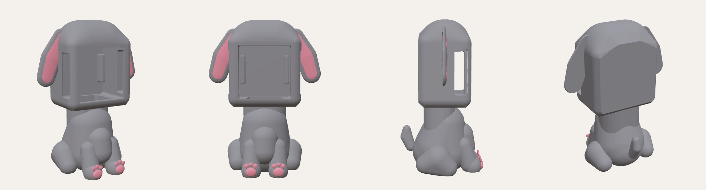
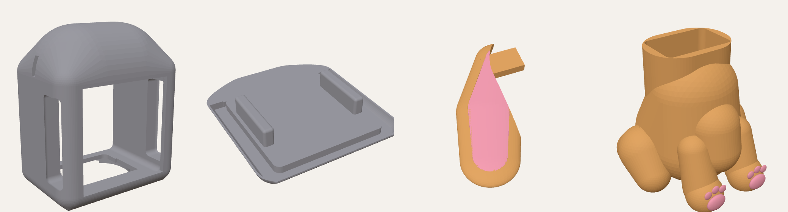
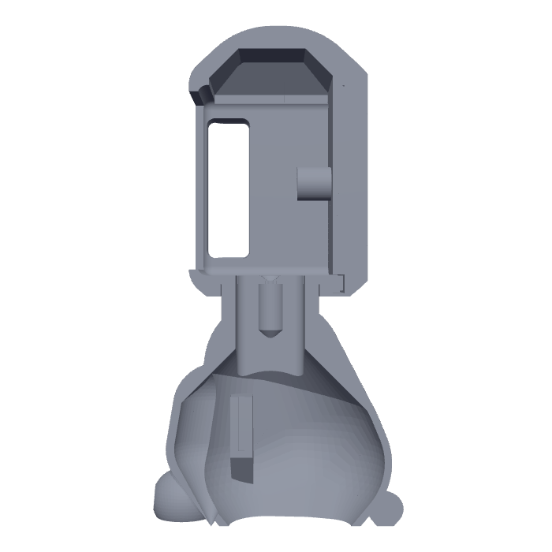
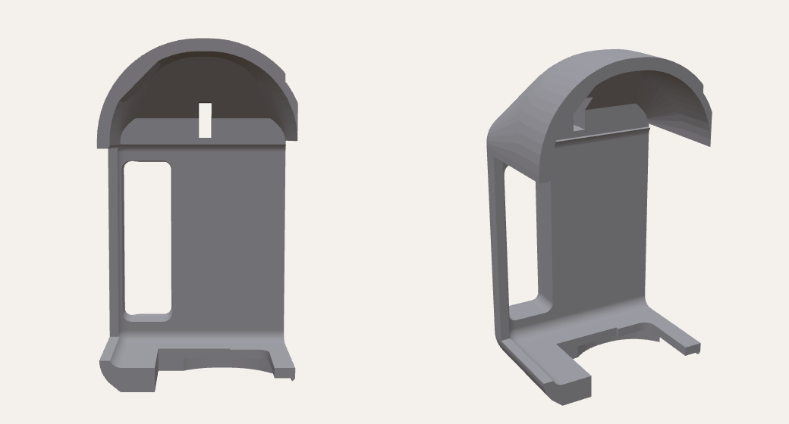
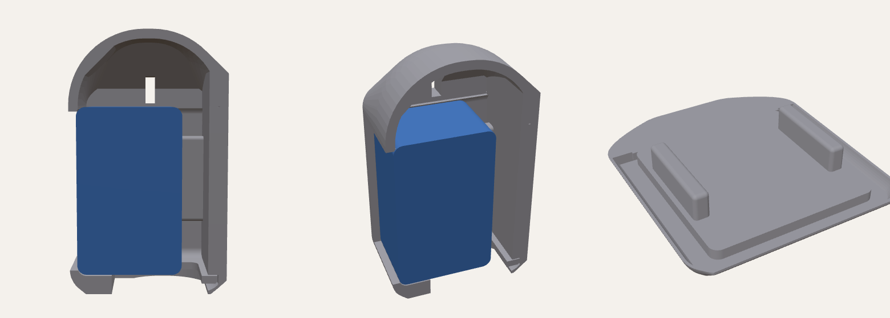

# Puppy body for Buddy

A chibi, sitting puppy body for the M5Stack CoreS3 with its DIN base
(33.5 mm deep), with floppy ears, pink inner ears and paw pads, room for Grove
cables, and an LD2410 presence radar in the chest.

Remixed from **"Puppy Stand - M5Stack Core S3" by John White**
(Printables), licensed **CC BY 4.0**
(https://creativecommons.org/licenses/by/4.0/). The openings for the CoreS3's
buttons and ports are placed where the original frame has them. This remix is
shared under the same license.

## Parts (`stl/`, already turned to their printing position)

| File | Size (mm) | Notes |
|---|---|---|
| `buddy_head.stl` | 71 x 47 x 85 | **Standing upright** on its bottom, as it sits on Buddy. The dome prints as a smooth top surface and the bottom edges are a 45-degree chamfer, so the outside needs no supports. The top of the screen window is a 50 mm bridge and the side windows 13.5 mm bridges: fine with normal bridging settings (add a support enforcer there if yours sag). The chamber's ceiling inside has a 45-degree roof and a ~25 mm bridge at the top, hidden inside. Tip: variable layer height smooths the top of the dome |
| `buddy_back_cap.stl` | 70 x 77 x 14 | **Back side down**, ribs and groove facing up (the groove stays clear of first-layer squish). The back edges are a 45-degree chamfer: no supports |
| `buddy_ear_left.stl` + `buddy_ear_left_pink.stl` | 34 x 55 x 4 | Flat side down, no supports. Load both as **one object with two parts**; pink part on the top |
| `buddy_ear_right.stl` + `buddy_ear_right_pink.stl` | 34 x 55 x 4 | Same |
| `buddy_body.stl` + `buddy_body_pink.stl` | 78 x 83 x 70 | Standing on its open bottom. Load both as **one object with two parts** (pink = paw pads). Supports: build plate only (chin, tail). The inside rises at 45 degrees, so nothing is needed inside |

Suggested: PLA, 0.2 mm layers, 3 walls, 15 % infill. In Anycubic Slicer Next
(or any Orca-based slicer), select a part and its `_pink` file together and
answer **Yes** to "load as a single object with multiple parts", then give the
pink part its own filament slot on the ACE Pro.

## Inside

- **Head:** the CoreS3 slides in from the back, screen first, against the front
  lip. Above it, a chamber with a 45-degree roof (about 17 mm of room above
  Ports B and C, 21 mm in the middle) gives Grove plugs room to bend; behind it an 8 mm gap carries cables down to the bottom opening,
  which leads into the neck. Side windows (both sides) for the power button,
  USB-C, Port A and the speaker, as on the original.
- **Back cap:** a U-shaped groove fits over a rim around the left, bottom and
  right of the head's back opening (0.35 mm clearance, with a lead-in on the
  rim). Two ribs on its inside press the CoreS3 against the front lip so it
  can't slide back when you touch the screen (0.2 mm play). Pull the cap off
  to take the CoreS3 out (for the SD card, for example).

  
- **Body:** hollow, open at the bottom. The neck on top is a hollow oval tube
  that fits into the socket under the head. In the chest, two grooved rails
  hold the radar board (22 mm wide, slides up from below) about 1 mm behind the
  chest wall, which the 24 GHz radar sees through.

## Assembly

1. Push each ear's tab into the slot on the side of the head (left ear on the
   left), with a drop of super glue.
2. Plug the Grove-to-jumper cable onto the radar (red VCC, black GND, yellow
   TX, white RX). Slide the board up into the chest rails from underneath,
   antenna side (the side with the chip and gold patches) facing forward, pins
   toward the bottom. A dab of hot glue holds it.
3. Feed the cable up through the neck.
4. Press the head onto the neck (glue if it's loose).
5. From the back, plug the cable into Port C (blue), then slide the CoreS3 in,
   screen first, letting the cable fold up into the dome. The USB-C power
   cable goes in through the left side window.
6. Press the back cap on.

Note: the DIN base's DC jack and power switch face down into the neck, as on
the original, so they can't be reached while assembled.

## Changing it

The model is code: `puppy.py` (needs `pip install manifold3d trimesh numpy`).

    python3 puppy.py stl/

Sizes worth checking against your parts are near the top of the file: the
CoreS3 pocket (`CORE`, `CORE_D`), the fit clearances (`CLEAR` 0.25 mm,
`RIM_CLEAR` 0.35 mm), the radar board (`RADAR_W`, `RADAR_T`), and, by the back
cap, `DEVICE_D` (33.5 mm) and `RIB_PLAY` (0.2 mm): if the CoreS3 still moves,
lower `RIB_PLAY`; if the cap won't close, raise it. `concept.py` is the earlier proportions model.
